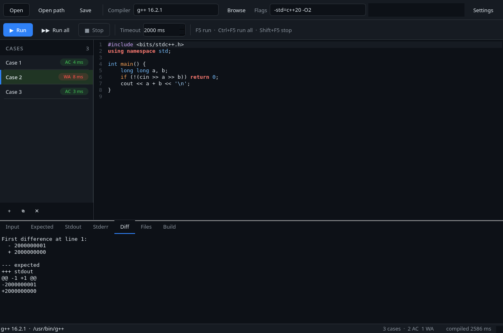
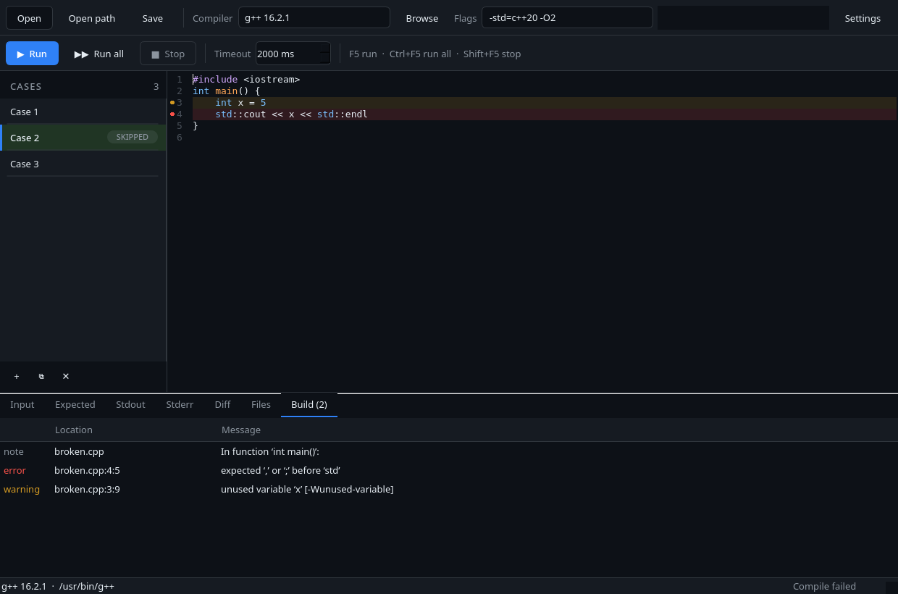

# C++ Helper

A single-window scratchpad for one-file C++ problems. Open a `.cpp`, paste the
input, press **F5**, read the output.

It handles both `cin`/`scanf` programs and file-based programs (`freopen`,
`ifstream`, `fopen`) without you ever creating or deleting a file.



## What it does

- **Cases** — several named input/expected pairs per session, add / duplicate /
  delete, run them all at once.
- **Verdicts** — `AC`, `PE`, `WA`, `TLE`, `RE`, `CE`, `RAN`, `SKIPPED`, with the
  per-case run time.
- **Diff** — the first differing line plus a unified diff against expected.
- **Files** — anything the program wrote (`sum.txt` from an `ofstream`, …) shows
  up in a tab instead of vanishing with the scratch directory.
- **Build** — compiler errors are clickable, jump to the line, and mark the
  gutter red (errors) or yellow (warnings).
- **Open by path** — `Ctrl+Shift+O`, paste any absolute path; quotes, `~`,
  `$VARS` and `file://` URLs are cleaned up.
- **Timeout** — wall clock, 2000 ms by default, editable per case.
- **Dark and light themes.**
- **Stateless** — nothing but your source file and four settings survive a
  restart. No recent files, no test history, no project files.

Everything is in memory: cases and results disappear when you close the window.

## Requirements

- Python 3.10+
- PySide6-Essentials and psutil (installed for you)
- A C++ compiler on `PATH` — `g++` or `clang++`

The compiler is detected on startup (including versioned `g++-15`, MinGW
installs found through the Windows registry, Homebrew, `/usr/local`, and so on).
If none is found, the start screen tells you what to install and lets you browse
for the executable.

## Run it

```bash
git clone https://github.com/<you>/cp-helper.git
cd cp-helper
./run.sh
```

`run.sh` creates `.venv` and installs the package on first launch. Open a file
directly by passing a path:

```bash
./run.sh examples/sum.cpp
```

Or do it by hand:

```bash
python3 -m venv .venv
.venv/bin/pip install -e .
.venv/bin/cpp-helper
```

On Windows:

```powershell
python -m venv .venv
.venv\Scripts\pip install -e .
.venv\Scripts\cpp-helper
```

## Using it

1. **Open** a `.cpp` — `Ctrl+O`, drag and drop, or paste its full path into the
   box on the start screen.
2. Type or paste the case **Input** and **Expected** output in the bottom tabs.
3. **Run** (`F5`) or **Run all** (`Ctrl+F5`).
4. Read **Stdout**, **Stderr**, **Diff**, or **Files**.

Leave **Expected** empty to use a case as a named input: the badge reads `RAN`
and nothing is compared.

### Shortcuts

| Keys                | Action                        |
| ------------------- | ----------------------------- |
| `Ctrl+O`            | Open file                     |
| `Ctrl+Shift+O`      | Open by pasting a path        |
| `Ctrl+S`            | Save the buffer to disk       |
| `F5` / `Ctrl+Enter` | Run the selected case         |
| `Ctrl+F5`           | Run every case in order       |
| `Shift+F5`          | Stop                          |
| `Tab` / `Shift+Tab` | Indent / unindent by 4 spaces |

### Verdicts

| Badge     | Meaning                                                        |
| --------- | -------------------------------------------------------------- |
| `AC`      | stdout matches expected byte for byte                          |
| `PE`      | matches after normalising CRLF and trailing whitespace         |
| `WA`      | different output — the Diff tab shows the first differing line |
| `TLE`     | exceeded the wall-clock limit                                  |
| `RE`      | non-zero exit (segfault, abort, uncaught exception)            |
| `CE`      | compilation failed; all cases are skipped                      |
| `RAN`     | expected output empty, so nothing was compared                 |
| `SKIPPED` | compile failed or you pressed Stop                             |



## How it works

- The editor buffer is the source of truth. It is written to the real file
  immediately before compiling.
- One compile per run: `<compiler> <flags> -pipe -Wall -o main main.cpp`, with
  a 15 s limit. Default flags are `-std=c++20 -O2`.
- Each case gets a fresh `cppjudge-<uuid>` directory under the system temp
  directory. The case input is written to `input.txt`; any filename found in a
  `freopen`/`ifstream`/`ofstream`/`fopen` call is created there too, so
  file-based solutions run with no setup. The directory is deleted afterwards.
- The program runs with pipes, not a PTY. Output is captured up to 8 MB per
  stream, and the process tree is killed on timeout with `psutil`.
- `#include "local.h"` works: sibling headers are copied next to the source.

## What is saved

Only two things:

- **Your source file**, written before every run.
- `settings.json` in `~/.config/cpp-helper/` (Windows:
  `%APPDATA%\cpp-helper\`), holding exactly four values: compiler path, flags,
  timeout, theme.

No cases, no results, no file paths, no recent files, no session restore.

## Limitations

These are deliberate, not bugs:

- **No PTY.** A program that prints a prompt without a newline and then waits
  for input will show nothing until it times out.
- **One file.** Local sibling headers work; general projects, build systems and
  third-party libraries do not.
- **Wall-clock limit only.** No memory limit and no sandbox.
- **8 MB output cap** per stream; beyond that the run is terminated.
- Compiler warnings never affect the verdict.

## Development

```bash
.venv/bin/python -m unittest discover -s tests -v
.venv/bin/ruff check cppjudge tests
```

```
cppjudge/
  core/            pure logic, no Qt except jobs.py
    compiler.py    discovery, probing, compile, diagnostics
    source_scan.py filename extraction from freopen/ifstream/fopen
    runner.py      scratch dirs, subprocess, timeout, tree kill, artifacts
    judge.py       verdicts and diffs
    jobs.py        QRunnable wrappers
    models.py      Case / Result / Diagnostic / Verdict
    session.py     in-memory state
    settings.py    the one persisted file
    paths.py       pasted-path resolution
  ui/
    main_window.py layout and wiring
    editor.py      line numbers, C++ highlighting, error marks
    cases_panel.py case list with verdict badges
    output_panel.py Input / Expected / Stdout / Stderr / Diff / Files / Build
    dialogs.py     settings, open-by-path, no-compiler banner
    theme.py       dark/light stylesheets
```

Each run is one `QRunnable` on `QThreadPool`: it compiles once, then runs the
requested cases in order, emitting signals that the GUI thread turns into widget
updates. Stop sets a `threading.Event` checked by the 50 ms wait loop, then
kills the process tree.

## Packaging

Optional — running from source is enough.

```bash
packaging/build-linux.sh            # dist/CppHelper/CppHelper
packaging/build-linux.sh appimage   # + dist/CppHelper-x86_64.AppImage
```

Windows has `packaging/build-windows.ps1` plus an Inno Setup script. See
[packaging/README.md](packaging/README.md).

## License

MIT — see [LICENSE](LICENSE). PySide6/Qt are LGPL and used through their
published wheels; no Qt code is vendored here.
